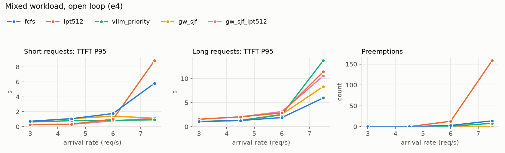
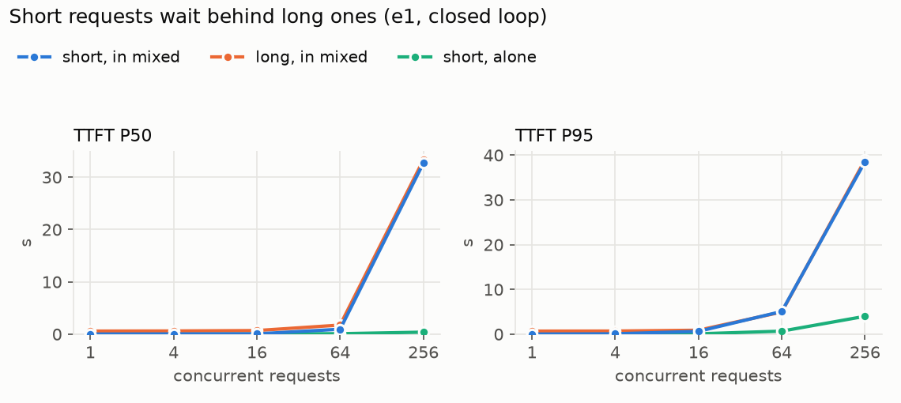
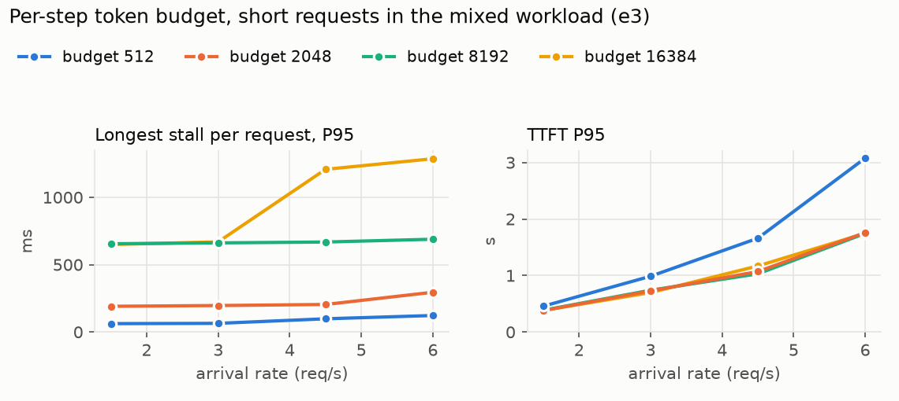
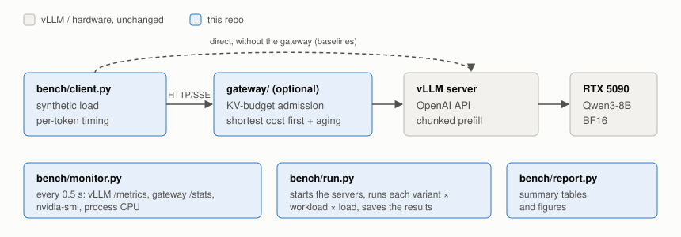

# vllm-mixed-workload-scheduling

**基于 vLLM 的混合长短请求调度：队头阻塞分析与 KV 感知准入网关**

*Serving Qwen3-8B with vLLM on a single RTX 5090: a benchmark harness that explains why short requests slow down next to long ones, and a KV-budget admission gateway (shortest-cost-first with aging) that brings short-request TTFT P95 from 5.8 s to 1.1 s under a burst overload, with zero preemptions.*

在单张 RTX 5090 (32 GB) 上用 vLLM 部署 Qwen3-8B，自写压测与监控框架，测出混合长短请求时短请求被长请求堵住的两个机制，并在 vLLM 前面实现了一个准入网关。

- 短请求首字延迟：约 1 分钟、超过容量约 20% 的突发过载下，短请求 TTFT P95 从 **5.81 s 降到 1.13 s**（对比 vLLM 默认 FCFS），全程零抢占，跑完同一批请求的时间不变（73.6 vs 73.5 s）。
- 相比 vLLM 自带优先级调度：短请求 P95 略高（1.13 vs 0.92 s），长请求则不再被一再压后：长请求 TTFT P95 从 13.8 s 降到 8.3 s，E2E P95 从 35.2 s 降到 17.8 s，抢占从 8 次降到 0。
- 低于容量时，问题出在单步内的 chunked prefill 争用，vLLM 已有的 `--long-prefill-token-threshold` 把短请求 TTFT P95 从 0.72 s 降到 0.28 s；接近和超过容量时，问题出在排队顺序，由网关处理。
- 代价与边界：长请求首字比 FCFS 晚（P95 从 5.97 s 增加到 8.34 s）；在长输出、共享前缀负载上，网关按 `max_tokens` 全额预留，吞吐下降 11-12%（见[适用与失效场景](#适用与失效场景)）。



| 方案（e4，混合负载） | 短请求 TTFT P95 @3 req/s | @6 | @7.5（过载） | 长请求 TTFT P95 @7.5 | 长请求 E2E P95 @7.5 | 抢占 @7.5 |
|---|---|---|---|---|---|---|
| vLLM 默认（FCFS） | 0.72 s | 1.76 s | 5.81 s | 5.97 s | 15.5 s | 14 |
| `--long-prefill-token-threshold 512` | **0.28 s** | 1.00 s | 8.84 s | 11.4 s | 19.7 s | 158 |
| vLLM `--scheduling-policy priority` | 0.63 s | 0.84 s | **0.92 s** | 13.8 s | 35.2 s | 8 |
| 网关，按到达顺序（只做 KV 准入） | 0.73 s | 1.83 s | 5.73 s | 5.90 s | 14.9 s | 0 |
| **网关，短优先 + 老化** | 0.72 s | 1.42 s | 1.13 s | 8.34 s | 17.8 s | 0 |
| 网关（短优先）+ threshold 512 | **0.28 s** | **0.77 s** | 1.13 s | 10.5 s | 18.8 s | 0 |

负载：85% 短请求（输入 192-320 / 输出 96-160 token）+ 15% 长请求（输入 6144-8192 / 输出 96-160），泊松到达，每档 480 个请求；容量约 6.2 req/s，7.5 req/s 一档约 64 s 内到达完，相当于一次突发过载。所有变体的请求序列与 KV 容量（91,664 token）完全相同。网关等待时间已计入 TTFT（客户端计时）。完整数据（含 4.5 req/s 一档、吞吐与收尾时间）：[`results/e4_admission/summary.csv`](results/e4_admission/summary.csv)。

## 结论

1. 两个机制问题叠加。
   - *步内争用*：开了 chunked prefill 后，每一步先满足已在运行的请求，一个正在 prefill 的长请求会吃满整步 token 预算（默认 2048），新到的短请求要等它的分块算完。e3 默认预算下，一个短请求在长请求（7,928 token）之后 18 ms 到达，首字时间 703 ms，与那个长请求（710 ms）几乎相同；1.5 req/s 的低负载下，短请求 TTFT 中位数 48 ms、P95 却约 380 ms。e1 闭环 16 并发时 KV 只用到 62%、没有抢占，混合负载中短请求 TTFT P95 已是单独跑短请求的 7 倍（0.64 vs 0.09 s）。
   - *排队的队头阻塞*：vLLM 0.32 调度等待队列时，队首请求拿不到 KV 就停止接纳（`vllm/v1/core/sched/scheduler.py`，`allocate_slots` 返回 `None` 即 `break`），且默认 `scheduler_reserve_full_isl=True` 要求整段输入放得下，于是 7k token 的长请求排在前面时，后面只需 300 token 的短请求也一起等。KV 吃满后这一项占主导：e1 闭环 256 并发时，混合负载里短、长请求 TTFT 中位数分别为 32.7 s 和 33.3 s，平均首次排队 29.7 s。
2. 两个机制要分别处理。步内争用用 vLLM 已有的 `--long-prefill-token-threshold` 解决（限制单个长请求每步最多占多少 token），低于容量时短请求 TTFT 尾部降到约 1/3；但它让更多请求同时“prefill 到一半”占着 KV，过载时抢占暴增（158 次），反而更差。排队顺序靠准入层：网关只在 KV 放得下时放行，并让短请求优先。
3. 组合的收益只属于短请求。网关 + threshold 512 在 6 req/s 及以下短请求 TTFT 最低（与单用 threshold 持平或更低），长请求 TTFT 也最高；过载时它对短请求的收益与单用网关相同（都是 1.13 s），长请求介于单用网关和单用 threshold 之间（10.5 s）。低负载的收益来自 threshold 参数。它比单用网关多花约 1.6 s 跑完这批（75.2 vs 73.6 s），差额几乎全在收尾：被推迟到最后的长 prompt 要在 512 token 一步的限制下算完。
4. 只做 KV 准入、不改顺序（网关按到达顺序）对短请求 TTFT 没有帮助，但过载时消除了抢占（从 14 次降到 0），两类请求 E2E P95 和 TPOT P95 略好（例如 E2E 从 16.1 s 降到 15.6 s，TPOT 从 84 ms 降到 78 ms）。
5. vLLM 自带的优先级调度让短请求最快，但长请求被一再压后：过载时长请求 TTFT P95 13.8 s、E2E P95 35 s（FCFS 15.5 s），有长请求在出字中途停了 48 s（该策略在 KV 不足时优先抢占优先级最低、即最长的请求）。网关用“老化”（等得越久越优先）平衡两者：老化系数 1000 tok/s 时，一个 8k token 的长请求等约 7.7 s 后排到新来的短请求前面，与实测长请求 TTFT P95 8.3 s 相符。老化不是硬性的等待上限；需要上限时用 `--max-wait`（超时返回 429），本项目实验未开启。
6. 网关的收益只在这类负载上成立：在长输出、共享前缀负载上它降低了吞吐、推迟了首字（见“适用与失效场景”）。
7. 低于容量时网关无影响：准入等待约 0.05 ms，经代理多一跳使 TTFT 中位数多约 1 ms，其余指标与直连一致。

其他发现：

- e2-前缀缓存：2048 token 共享前缀时，开启前缀缓存吞吐 11.2 vs 3.8 req/s（约 2.9 倍），因为重复的 prefill 不用再算、共享的 KV 块只存一份（64 并发时 KV 峰值 42% vs 100%）。前缀不共享时开关无差别（3.84 vs 3.82 req/s）。256 并发时开启后 TPOT P95 反而更高（138 vs 76 ms）：同时运行的请求从 37 个增至 204 个，decode 批更大，KV 重新吃满后还发生 123 次抢占；但首字和 E2E 仍大幅改善。
- e3-每步 token 预算：预算越大，长 prompt 越可能一步做完，但这一步里所有正在出字的请求都停住。单请求最长卡顿 P95：预算 512 时 60-120 ms，2048 时 190-360 ms，8192 时约 660 ms，16384 时最长 1.3 s。512 则让 prefill 太慢，高负载时短请求 TTFT P50 806 ms（2048 为 234 ms）。默认 2048 是合理折中；8192 在 6 req/s 时短请求 TTFT 中位数略低（164 vs 234 ms），但 P95 相同（1.74 vs 1.76 s），不足以支持改默认值。
- e1-过量接纳：长输出负载 256 并发时 vLLM 抢占 2784 次，跑完这批的平均吞吐与 64 并发相同（3.4 req/s），E2E P95 却从 22 s 涨到 86 s。vLLM 接纳时只检查输入是否放得下，不为将要生成的输出预留。
- 解码访存受限：单请求 TPOT 10.3 ms；按每步读一遍约 16 GB 权重估算，有效带宽约 1.6 TB/s，约为显存带宽峰值的 89%。全程 vLLM 调度进程 CPU 约 12-21%，不是 CPU 瓶颈。




## 架构



| 本项目 | vLLM 已有（只做了配置与对照） |
|---|---|
| `gateway/`：按 `prompt + max_tokens`（按 16 token 块取整）预留 KV，预算读自 vLLM 的 `kv_cache_size_tokens`；等待队列按 `代价 - 老化系数 × 已等秒数` 排序；队首放不下时不回填后面的请求；`--max-wait` 超时返回 429；上游出错返回 502 | chunked prefill、`--max-num-batched-tokens`、`--long-prefill-token-threshold`、`--scheduling-policy priority`、前缀缓存、`max_num_queued_reqs`（超出即 503 的粗粒度阀门，本项目未使用） |
| `bench/`：确定性合成负载、闭环/开环（泊松）压测、逐请求 TTFT/TPOT/卡顿记录、指标采集与汇总 | `/metrics`、`/reset_prefix_cache`（开发模式） |

## 适用与失效场景

- 适用：长短请求混跑、输出较短（预留浪费小）、负载会接近或超过容量、在意短请求（交互）尾延迟的服务。
- 不需要：负载长期低于容量。此时问题只在步内，`--long-prefill-token-threshold` 一个参数就够。
- 代价：长请求首字比 FCFS 晚（过载时 P95：FCFS 5.97 s，网关 8.34 s，组合 10.5 s）。单用网关跑完这批的时间与直连相同（73.6 vs 73.5 s）；组合方案多 2%，来自收尾阶段。
- e5-长输出、共享前缀负载上是取舍：网关在接纳时按 `prompt + max_tokens` 全额预留。在输出短的混合负载上这几乎没有浪费，但：

  | 过载点 | 方案 | 吞吐 | TTFT P95 | TPOT P95 | 最长卡顿 P95 | E2E P95 | KV 峰值 | 抢占 |
  |---|---|---|---|---|---|---|---|---|
  | 长输出（输入 ~256 / 输出 768-1280），4.5 req/s | vLLM 默认 | 3.39 req/s | 0.13 s | 24 ms | 141 ms | 28.2 s | 100% | 16 |
  | | 网关 | 2.98 req/s（-12%） | 13.4 s | 20 ms | 75 ms | 33.1 s | 65% | 0 |
  | 共享前缀（2048 共享 / 总长 ~2400），12 req/s | vLLM 默认 | 10.8 req/s | 0.35 s | 65 ms | 207 ms | 9.6 s | 61% | 0 |
  | | 网关 | 9.66 req/s（-11%） | 6.1 s | 27 ms | 113 ms | 9.3 s | 28% | 0 |

  网关压低了同时运行的请求数，出字因此更平稳（共享前缀时 E2E 甚至略好），但请求在网关里等，首字大幅推迟，吞吐下降。根源是预留与实际占用不符：一个请求的 KV 随出字逐步长满，平均只占预留量的一半左右；共享前缀在 vLLM 里只存一份，网关却对每个请求重复计算。真实请求的 `max_tokens` 常远大于实际输出，浪费会按比例更大。
- e6-超配且无法兼顾：把网关预算放大到 KV 容量的 1.5 / 2 倍，三种负载各取一个过载点：

  | 预算倍数 | 混合：短请求 TTFT P95 | 长输出：吞吐 / TTFT P95 / 抢占 | 共享前缀：吞吐 / TTFT P95 |
  |---|---|---|---|
  | vLLM 默认 | 5.51 s | 3.39 req/s / 0.13 s / 10 | 10.8 req/s / 0.35 s |
  | 1.0 | **1.13 s** | 2.98 / 13.4 s / 0 | 9.65 / 6.16 s |
  | 1.5 | 5.28 s | 3.37 / 1.46 s / 0 | 10.4 / 2.69 s |
  | 2.0 | 5.76 s | 3.39 / 0.13 s / 15 | 10.4 / 2.17 s |

  混合负载只在 1.0 时有效：放大到 1.5 倍，请求很快离开网关，vLLM 自己的等待队列重新堆起来（最多 41 个），排序失去作用，队头阻塞随之回来。长输出要 1.5 倍才收回吞吐（仍无抢占，但 TTFT 尾部仍差），2 倍就等于不设网关。没有一个静态倍数同时适合三种负载，原因有两层：按声明的 `max_tokens` 预留是错误的信号；同一个预算参数同时决定了放多少请求进去和排序还能起多大作用。合理的下一步是把两者拆开：按 vLLM 实际 KV 占用（`/metrics` 的 `kv_cache_usage_perc`）做反馈式准入，排序策略单独保留。

## 复现

环境：Ubuntu，RTX 5090 32 GB（驱动 580.178），Python 3.12，vLLM 0.32.0（torch 2.13.0 + CUDA 13.0），模型 [Qwen/Qwen3-8B](https://huggingface.co/Qwen/Qwen3-8B) @ `b968826`，BF16。

```bash
pip install -e ".[test]"
pytest                                                                 # 单元测试，CPU 即可
# FlashInfer 的采样核在首次使用时现场编译；装官方预编译包可免去 nvcc 依赖
pip install "flashinfer-jit-cache==0.7.0.post1+cu130" --index-url https://flashinfer.ai/whl/cu130
hf download Qwen/Qwen3-8B --revision b968826d9c46dd6066d109eabc6255188de91218 --local-dir models/Qwen3-8B

scripts/reproduce.sh models/Qwen3-8B                                   # 全部实验
scripts/reproduce.sh models/Qwen3-8B experiments/e4_admission.toml     # 只跑一个
python scripts/figures.py                                              # 用 results/ 重画 README 的图
```

新结果写到 `runs/`，不覆盖仓库里的 `results/`。单独起网关：`python -m gateway --upstream http://127.0.0.1:8000 --port 8200`。

| 实验 | 问题 |
|---|---|
| `e1_baseline` | 默认配置下 6 种负载 × 1-256 并发（闭环）的基线 |
| `e2_prefix_caching` | 前缀缓存开/关 × 共享/不共享前缀 |
| `e3_prefill_budget` | 每步 token 预算 512 / 2048 / 8192 / 16384，混合负载开环 |
| `e4_admission` | 框架参数 vs 网关，单独与组合，混合负载开环到过载 |
| `e5_gateway_limits` | 网关在长输出、共享前缀负载下的表现（失效场景） |
| `e6_overcommit` | 网关预算超配 1.0 / 1.5 / 2.0 倍，三种负载的过载点 |

每个用例的原始数据在 `results/<实验>/<变体>/<负载>/<压力>/`：`requests.jsonl`（逐请求）、`metrics.jsonl.gz`（时间序列）、`metrics_{before,after}.prom`（原始抓取）、`gpu.csv`、`meta.json`（实验条件）；服务日志在 `<变体>/server.log`。

## 测量说明与局限

- 合成负载：prompt 是随机 token ID，经 completions 接口发送，`ignore_eos` 保证输出长度精确。这样长度可控、可复现，但不反映真实文本的提前结束。
- 计时口径：客户端按每个 token 的到达计时（请求 `return_token_ids`）。e1-e6 采集时用的是早期版本，按非空文本块计时：一个 token 可能解码为空文本（半个 UTF-8 字符），此时它的到达时刻记在下一个非空块上。
- 指标口径：`tpot_p95` 是“每请求平均 TPOT”的 P95；`itl_max_p95`（最长卡顿）是“每请求最长一次出字间隔”的 P95，不是所有间隔的 P95。`queue_mean` 是 vLLM 的首次排队时间（不含网关等待，也不含抢占后的再次等待）。KV、运行数等是每 0.5 s 的采样值。
- 闭环与开环：闭环（固定并发）用于测容量；开头 N 个请求同时到达会抬高 TTFT 尾部，因此时延结论以开环（泊松到达）为准。
- 排队时间：vLLM 排队时间直方图第一个桶是 0.3 s，分位数不可信，只报告由 sum/count 得到的均值。
- KV 容量每次启动不同（82k-92k token），每个用例的值记在 `summary.csv` 的 `kv_cache_tokens` 列。原因是 torch.compile：vLLM 启动时测一次显存峰值，再把剩余预算分给 KV；当次需要现编译（日志 `Compiling a graph`）时峰值偏高，KV 就少（82k-85k）；直接加载已有编译结果（`Directly load AOT compilation`）时是 91,664。e2、e4、e5、e6 的所有变体都是 91,664，可直接比较；e1 是 84,576；e3 四档分别为 84,752 / 91,664 / 83,888 / 82,096。之后的实验可用 `--kv-cache-memory-bytes` 固定容量。
- 重复性：e6 重跑了 e4 的两个配置，过载点短请求 TTFT P95 分别为 5.51 vs 5.81 s（vLLM 默认）、1.13 vs 1.13 s（网关），同配置跑间差异约 5%。
- 预热与缓存清空：每次启动后预热 32 个请求（输入 64-2048）；每个用例前清空前缀缓存。
- 单卡、单模型、单副本；未做量化、多卡与 SGLang 对照。

## 仓库结构

```
bench/        压测：workloads, client, monitor, server, run, report
gateway/      准入网关：admission（策略）, __main__（HTTP 代理）
experiments/  每个实验一个 TOML
results/      本文的原始数据、汇总表、逐实验图
scripts/      reproduce.sh（跑实验）、figures.py（README 图）
tests/        单元测试（pytest）
docs/figures/ README 用图
```
